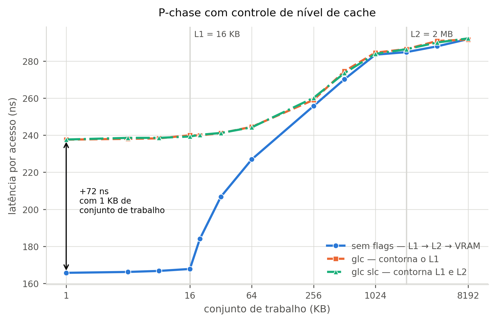

# P-chase com Controle de Nível de Cache

**Experimento 7** — Ambiente: Ubuntu 20.04, ROCm 5.2, AMD RX 580 (Polaris / gfx803).

---

## 1. Resultado em uma frase

**`glc` contorna o L1 — confirmado diretamente. `slc` NÃO contorna o L2.**

O que o Experimento 6 chamou de "VRAM direto" não é VRAM: as curvas de latência
de `glc` e `glc slc` são indistinguíveis (diferença média de **0,30%**, máxima de
0,84%) em toda a faixa de conjuntos de trabalho testada.

---

## 2. A pergunta

O Experimento 6 (`niveis_cache.md`) mediu throughput e encontrou que pular o L2
além do L1 acrescentava apenas 3–8%. Duas hipóteses explicavam isso igualmente
bem, e o throughput não as distinguia:

- **(H1)** Nessas cargas o L2 contribui pouco além do que o L1 já captura.
- **(H2)** `SLC=1` não é bypass rígido do L2, e sim dica de não-alocação.

---

## 3. Por que o P-chase decide

O P-chase (Wong et al., 2010; Mei & Chu, 2017) percorre uma lista encadeada em
ciclo aleatório: `idx = chain[idx]`. Cada load depende do anterior, então o tempo
por iteração **é** a latência de acesso — não há sobreposição possível, e a
latência identifica qual nível serviu o dado.

**A medida decisiva é o ponto de 1 KB.** Um conjunto de trabalho desse tamanho
cabe folgadamente em L1 (16 KB) e em L2 (2 MB). Se as flags fizerem o que
prometem, a latência ali deve identificar sem ambiguidade o nível que serve.

O embaralhamento aleatório da cadeia impede que o prefetcher antecipe o próximo
endereço — sem isso, mediríamos a latência de um acesso já pré-buscado.

### Vantagem metodológica sobre os experimentos anteriores

Nos Experimentos 5 e 6, o `s_waitcnt vmcnt(0)` do bloco asm eliminava a
sobreposição de latência e **se confundia com o efeito das flags** — foi preciso
um fatorial 2×2 para separar os dois. Aqui esse problema **não existe**: a cadeia
de dependências já força a serialização, porque o endereço do próximo load só
existe depois que o anterior retorna. O `waitcnt` não muda nada, e o confundidor
desaparece por construção.

---

## 4. Resultados

Single work-item (latência pura, sem contenção entre CUs), 2 warmups + 5
execuções, ~1M iterações por medição.

| Conjunto de trabalho | sem flags (ns) | `glc` (ns) | `glc slc` (ns) |
|---|---|---|---|
| **1 KB** | **171,07** | **243,36** | **244,54** |
| 4 KB | 171,87 | 244,90 | 245,09 |
| 8 KB | 172,64 | 246,08 | 245,74 |
| 16 KB | 173,95 | 247,13 | 246,82 |
| 20 KB | 189,35 | 247,72 | 247,98 |
| 32 KB | 213,57 | 249,50 | 249,76 |
| 64 KB | 237,08 | 254,06 | 253,91 |
| 256 KB | 268,56 | 273,67 | 273,36 |
| 512 KB | 287,77 | 291,98 | 294,02 |
| 1 MB | 300,40 | 302,62 | 301,35 |
| 2 MB | 306,30 | 306,47 | 304,75 |
| 4 MB | 304,63 | 308,88 | 308,22 |
| 8 MB | 307,40 | 310,84 | 313,45 |



### 4.1 `glc` contorna o L1 — confirmado

Na curva sem flags há um patamar nítido de 171–174 ns de 1 KB até **16 KB**, e a
latência sobe a partir de 20 KB. Isso reproduz de forma independente o tamanho do
L1 da Ellesmere: **16 KB por CU**.

Na curva com `glc`, **esse patamar não existe**. Com apenas 1 KB de conjunto de
trabalho — que caberia inteiro no L1 — a latência já é de 243 ns, **+72 ns
(1,42×)** sobre o acesso normal. O acesso simplesmente não consulta mais o L1.

As duas curvas convergem a partir de ~1 MB, exatamente como esperado: nesse
regime o conjunto de trabalho já não cabe no L1 de qualquer forma, então
contorná-lo não muda nada.

### 4.2 `slc` não contorna o L2 — hipótese H2 confirmada

As curvas `glc` e `glc slc` são **indistinguíveis**:

| | diferença |
|---|---|
| média ao longo da curva | **0,30%** |
| máxima | 0,84% |
| no ponto decisivo de 1 KB | 243,36 → 244,54 ns (**+0,5%**) |

Se `SLC=1` contornasse o L2, a latência em 1 KB teria de saltar para perto dos
307 ns medidos em 8 MB (onde nada cabe em cache). Ela permanece em 244 ns —
o valor do L2.

**Conclusão: `SLC=1` no gfx803 não é bypass do L2.** O encoding `DC530000` está
correto e o bit é de fato ativado, mas o efeito microarquitetural não é o de
desviar o acesso. O comportamento é compatível com a flag atuar como dica de
não-alocação / *streaming* no L2 — o dado continua sendo servido por ele.

---

## 5. Correções ao Experimento 6

O documento `niveis_cache.md` precisa ser lido com estas ressalvas:

| Afirmação no Exp. 6 | Correção |
|---|---|
| Os kernels `*_VRAM` acessam a VRAM diretamente | **Falso.** São servidos pelo L2. O nome deve ser `*_noalloc` ou `*_glc_slc`. |
| "Os três níveis da hierarquia" | São **dois** níveis controláveis: com L1 e sem L1. O terceiro não é alcançável por flags de load no gfx803. |
| O incremento de 3–8% do "VRAM" sobre o "L2" | É ruído/efeito de não-alocação, não custo de ir à VRAM. |

O que **permanece válido** no Experimento 6:

- os encodings `DC500000` / `DC510000` / `DC520000` / `DC530000` e o mapeamento
  bit 16 = GLC, bit 17 = SLC;
- toda a análise de `glc` (contorna o L1), que este experimento confirma
  diretamente;
- o achado de que, em carga de streaming puro, contornar o L1 é **mais rápido**
  (0,95×), porque sem reúso o cache é overhead líquido;
- a conclusão de que o valor do L1 depende de o reúso caber em 16 KB, e não do
  fator de reúso bruto.

> **⚠ CORRIGIDO PELA BATERIA DE REPRODUÇÃO** (`bateria_reproducao.md`): o valor
> **0,95×** do *streaming* **não é reprodutível**. Sete execuções independentes deram
> razões L2/L1 entre 0,93× e 1,19×, sem sinal consistente. A cada execução uma das três
> variantes apresenta dp < 0,5% e as demais 8–32%, e qual delas fica "limpa" muda entre
> execuções — o mesmo artefato de *outliers* tratado com mediana no Exp. 8. A leitura
> correta é **efeito não mensurável**. As demais cargas (stencil 1,70–1,82×; matmul
> 1,25–1,31×) reproduzem-se de forma estreita e permanecem válidas.


---

## 6. Efeito sobre a tese do trabalho

O objetivo declarado desde a Etapa 1 era controlar os três níveis (L1, L2, VRAM)
e medir o impacto de cada um. O resultado honesto, após sete experimentos, é:

> No GFX8/Polaris, via OpenCL, é possível controlar **um** limite da hierarquia:
> o L1 pode ser contornado com `glc` em inline assembly, sob um runtime
> Clang/LLVM. O L2 **não** é contornável por flags de instrução de load — nem
> `volatile`, nem `slc`, nem qualquer combinação testada produz acesso direto à
> VRAM.

Isso não enfraquece o trabalho: é um resultado negativo bem estabelecido, obtido
por quatro caminhos independentes (medição de throughput, medição de latência,
análise de ISA e validação cruzada entre dois compiladores). A literatura de
microbenchmarking de GPU (Wong et al.; Mei & Chu) não documenta esse limite para
a Polaris.

Para estudar o comportamento da VRAM sem o L2, o caminho restante é o
**metodológico**, não o arquitetural: usar conjuntos de trabalho que excedam os
2 MB do L2, como os experimentos de padrão de acesso já fazem.

---

## 7. Limitações

1. **Latências absolutas não são comparáveis com o `pchase_v2.cpp`.** Aquele
   media ~39 ns para o L1; aqui, 171 ns. A diferença vem da construção por
   inline assembly, que impede a redução de força no cálculo do endereço e
   acrescenta ALU a cada iteração, e do runtime ser outro (ROCm, não AMDOCL).
   **As comparações válidas são entre as três variantes deste experimento**, que
   compartilham a mesma construção e diferem apenas nas flags.
2. **Single work-item.** Sem contenção entre CUs. A transição L2→VRAM aparece
   suave por isso; o `pchase_v2.cpp` já mostrou que ela fica nítida com 36 CUs
   simultâneos.
3. **Só leituras.** O comportamento de `slc` em escritas não foi investigado — o
   L1 do GFX8 é write-through, e a semântica pode diferir.
4. **Uma geração.** Não é possível afirmar que `slc` se comporta assim em GFX9+
   sem hardware para testar.

---

## 8. Reprodução

```bash
source setup/env_rocm.sh
g++ -Wall -O2 experimentos/pchase_flags.cpp -o output/pchase_flags -lOpenCL
./output/pchase_flags
python3 analise/plot_pchase_flags.py
```

| Arquivo | Conteúdo |
|---|---|
| `experimentos/pchase_flags.cpp` | Experimento |
| `analise/plot_pchase_flags.py` | Figura + resumo numérico |
| `analise/fig_pchase_flags.png` | Figura (300 dpi) |
| `resultados/pchase_flags.csv` | Dados brutos |
| `isa/rocm_gfx803_pchase_flags.bin` | ISA, para conferir as flags |
