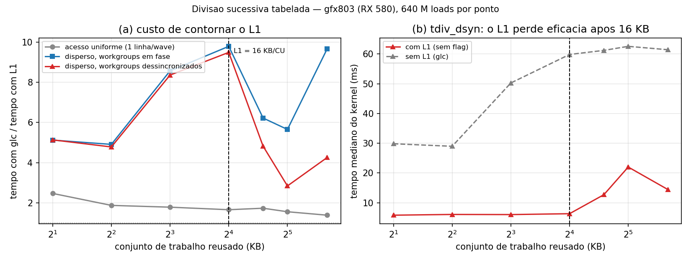

# A Fronteira dos 16 KB, Medida num Algoritmo

**Experimento 10** — Ambiente: Ubuntu 20.04, ROCm 5.2, AMD RX 580 (Polaris / gfx803).

---

## 1. Resultado em uma frase

Varrendo o conjunto de trabalho reusado de 2 KB a 51 KB no algoritmo do
Experimento 9, o custo de contornar o L1 **cresce até um pico de 9,39× exatamente
em 16 KB — a capacidade do L1 por CU — e cai para 2,78× logo acima**. O
Experimento 7 tinha localizado essa fronteira por latência, com P-chase e um
único work-item; aqui ela aparece em vazão, num algoritmo real, com a GPU inteira
saturada.



---

## 2. Desenho

A tabela contém os *k* primeiros primos ímpares (até `lim = p_k`) e os candidatos
ficam em **[lim² − n_cand, lim²)**. Assim todo fator primo de qualquer candidato
é ≤ √vmax = lim e está na tabela: nenhum primo é supérfluo e o teste permanece
exato. O limite superior da varredura vem da aritmética de 32 bits — `lim < 65536`
para que `lim²` caiba em `uint` — o que dá uma tabela máxima de 6.541 primos,
**51 KB**.

O número total de loads é mantido constante em ~640 M ajustando `n_cand`, para
que os pontos da curva sejam comparáveis em tempo.

### As três variantes de acesso

| Variante | Índice inicial do lane | Linhas de cache por instrução de load |
|---|---|---|
| `tdiv_unif` | `0` | 1 |
| `tdiv_rot` | `37·lane mod k` | min(64, linhas da tabela) |
| `tdiv_dsyn` | `(2654435761·gid_grupo + 37·lane) mod k` | idem, mas grupos em regiões disjuntas |

**A terceira variante foi necessária, e o motivo é o achado metodológico deste
experimento.** A primeira rodada usou apenas `tdiv_rot` e a razão *não* colapsou
após 16 KB — ficou em 9,40× com tabela de 51 KB. A causa: como todos os
work-items avançam com `i++` em *lock-step*, as wavefronts de um mesmo CU
percorrem a tabela **em fase**, e a janela viva a qualquer instante é de ~64
linhas (4 KB), qualquer que seja o tamanho da tabela. A varredura variava o
volume total de dados reusados, não o **conjunto ativo**, que é o que o L1
precisa reter.

Multiplicar o `group_id` pela constante de Knuth (2654435761 = 2³²/φ) distribui
os grupos por toda a tabela, de modo que as wavefronts residentes num mesmo CU
leiam regiões disjuntas. O trabalho e o *trip count* são idênticos — só muda o
ponto de partida do percurso circular.

> Registro para o artigo: **"conjunto de trabalho" em cache de GPU é o conjunto
> de linhas vivas simultaneamente, não o volume de dados reusados.** Duas cargas
> com o mesmo reúso sobre a mesma tabela podem pressionar o L1 de formas
> completamente diferentes conforme as wavefronts estejam em fase ou não.

---

## 3. A curva

Razão tempo(`glc`) / tempo(L1), mediana de 15 execuções:

| Working set | `tdiv_unif` | `tdiv_rot` | **`tdiv_dsyn`** |
|---|---|---|---|
| 2 KB | 2,333× | 5,109× | 5,060× |
| 4 KB | 1,913× | 4,887× | 4,791× |
| 8 KB | 1,824× | 8,533× | 8,326× |
| **16 KB** | 1,725× | 9,629× | **9,390×** ← pico |
| 24 KB | 1,748× | 6,116× | **4,823×** |
| 32 KB | 1,593× | 5,646× | **2,784×** |
| 51 KB | 1,384× | 9,397× | 3,455× *(ver §5)* |

Todos os 63 pontos foram verificados contra referência em CPU por divisão inteira
— técnica independente do teste de Granlund-Montgomery usado no kernel.

### O que cada trecho da curva mede

**Subida de 2 KB a 16 KB.** Não é o L1 ficando mais eficaz, e sim o número de
requisições por instrução crescendo. Uma tabela de 2 KB ocupa 32 linhas de 64 B,
então os 64 lanes dispersos tocam no máximo 32 linhas; a partir de 4 KB são 64
linhas, uma por lane. Isso aparece nítido no tempo do nível `glc`, que **dobra de
~30 ms para ~60 ms exatamente entre 4 KB e 8 KB** e satura ali: sem L1, o tempo é
proporcional ao número de requisições servidas pelo L2, e o número de requisições
saturou.

**Queda depois de 16 KB.** Aqui o numerador está saturado e quem se move é o
denominador: o tempo *com* L1 salta de 6,4 ms (16 KB) para 12,7 ms (24 KB) e 22,2
ms (32 KB). O L1 deixa de reter o conjunto ativo e passa a errar — o nível "com
cache" converge para o nível "sem cache". É a mesma assinatura do P-chase do
Experimento 7, agora em vazão.

O painel (b) da figura mostra isso de forma direta: a curva `glc` (cinza) é
monótona e satura; a curva com L1 (vermelha) é **plana em ~6 ms até 16 KB** e só
então dispara.

---

## 4. Comparação com o Experimento 7

| | P-chase (Exp. 7) | Divisão tabelada (Exp. 10) |
|---|---|---|
| Grau de paralelismo | 1 work-item | GPU saturada (36 CUs) |
| Grandeza medida | latência | vazão |
| Efeito no ponto ótimo | 1,42× | **9,39×** |
| Fronteira detectada | entre 16 e 20 KB | pico em 16 KB |

Os dois experimentos localizam a mesma fronteira por caminhos independentes, e a
diferença de magnitude (1,42× contra 9,39×) quantifica quanto do valor do L1 vem
de **absorver contenção** e não de encurtar o caminho: sob carga, o L1 vale ~6,6
vezes mais do que sua vantagem de latência isolada sugere.

---

## 4b. Reprodutibilidade

Quatro execuções independentes da varredura, razão L2/L1 do `tdiv_dsyn`:

| Working set | mín | máx | mediana | dp |
|---|---|---|---|---|
| 2 KB | 4,936 | 5,076 | 5,028× | 1,3% |
| 4 KB | 4,697 | 4,791 | 4,740× | 0,8% |
| 8 KB | 8,214 | 8,365 | 8,337× | 0,8% |
| **16 KB** | 9,180 | 9,407 | **9,328×** | 1,2% |
| 24 KB | 4,823 | 4,919 | 4,897× | 0,9% |
| 32 KB | 2,784 | 2,858 | 2,820× | 1,1% |
| 51 KB | 3,455 | 4,355 | 4,039× | **9,6%** |

A forma da curva — subida até 16 KB e queda depois — reproduz-se integralmente,
com dispersão inferior a 1,3% em todos os pontos **exceto o de 51 KB**, que
sozinho apresenta 9,6%. Essa é a assinatura esperada da limitação §5.1: naquele
ponto restam ~191 workgroups (5,3 por CU), e a ocupação baixa torna o conjunto
ativo por CU instável entre execuções. O ponto anômalo da curva é também o único
instável — o que sustenta a explicação por ocupação em vez de efeito de cache.

---

## 5. Limitações

1. **Ocupação varia ao longo da curva.** Manter os loads constantes em 640 M
   obriga `n_cand` a cair de 1,25 M para 48.896 conforme *k* cresce — de 4.882
   para 191 workgroups. No último ponto (51 KB) restam ~5,3 workgroups por CU, e
   com tão poucas janelas ativas simultâneas o conjunto ativo por CU volta a
   caber parcialmente no L1. É a explicação mais provável para a razão subir de
   2,78× (32 KB) para 3,46× (51 KB), contra a tendência. Um refinamento seria
   fixar o número de workgroups e deixar o tempo crescer com *k*.
2. **Teto de 51 KB.** A aritmética de 32 bits limita `lim < 65536`. Ir além exige
   candidatos em `ulong`, o que dobra o custo do teste e altera a razão
   load/ALU — não seria o mesmo kernel.
3. **`s_waitcnt vmcnt(0)` por load** suprime o *memory-level parallelism*
   intra-thread, como em todos os experimentos com *inline assembly* deste
   trabalho. As comparações entre níveis permanecem válidas porque as três
   variantes compartilham a construção.

---

## 6. Verificação de ISA

```
kernel              inst  laço  loads  vmcnt  flags de cache
tdiv_unif_L1          52    23      2      2  GLC=0 SLC=0
tdiv_rot_L1           68    21      2      2  GLC=0 SLC=0
tdiv_dsyn_L1         160    21      2      2  GLC=0 SLC=0
tdiv_dsyn_L2         160    21      2      2  GLC=1 SLC=0
tdiv_dsyn_VRAM       160    21      2      2  GLC=1 SLC=1
```

`tdiv_dsyn` tem 160 instruções contra 68 do `tdiv_rot` — a multiplicação de Knuth
e o resto, executados **uma vez por work-item, fora do laço**. O corpo do laço é
idêntico (21 instruções, 2 loads), e a comparação entre níveis é feita dentro de
cada kernel.

---

## 7. Reprodução

```bash
source setup/env_rocm.sh
g++ -Wall -O2 experimentos/tdiv_ws.cpp -o output/tdiv_ws -lOpenCL
./output/tdiv_ws                       # ~3 min, a partir da raiz do projeto
python3 analise/plot_tdiv_ws.py
```

| Arquivo | Conteúdo |
|---|---|
| `experimentos/crivo_l1.cl` | Kernels (compartilhados com o Experimento 9) |
| `experimentos/tdiv_ws.cpp` | Anfitrião da varredura, tabelas e verificação |
| `resultados/tdiv_ws.csv` | Dados brutos, 63 pontos |
| `analise/plot_tdiv_ws.py` | Figura |
| `analise/fig_tdiv_ws.png` | Figura gerada |
